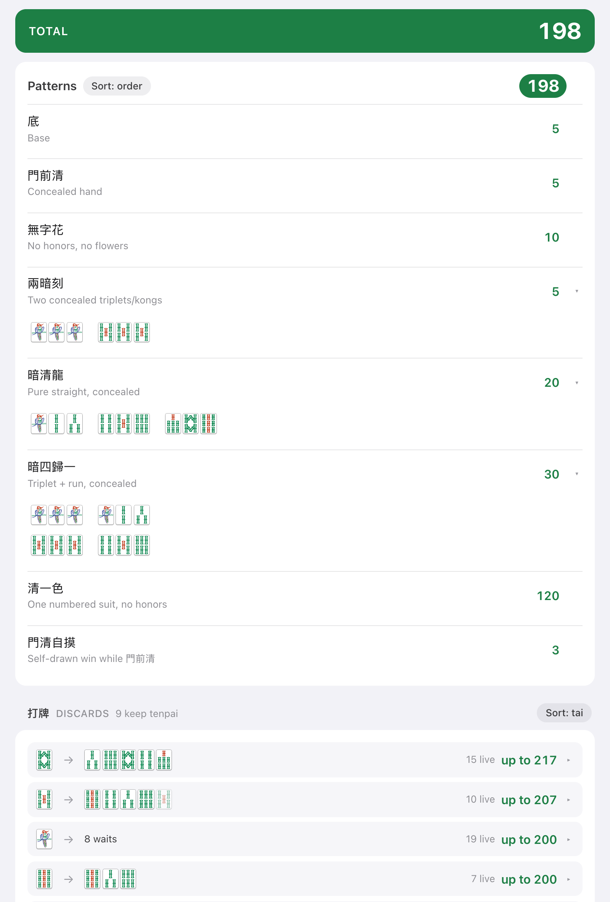
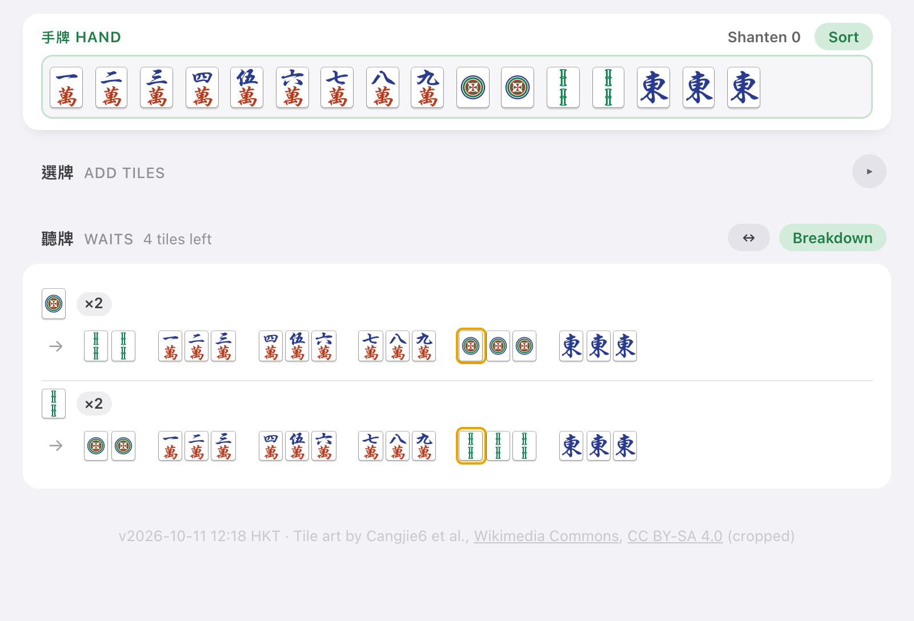
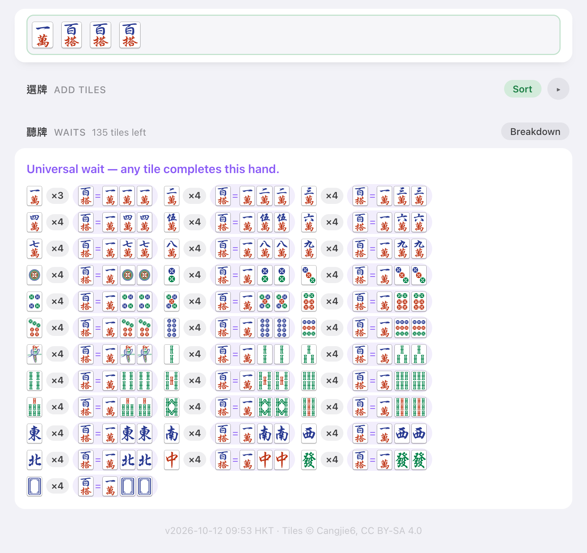
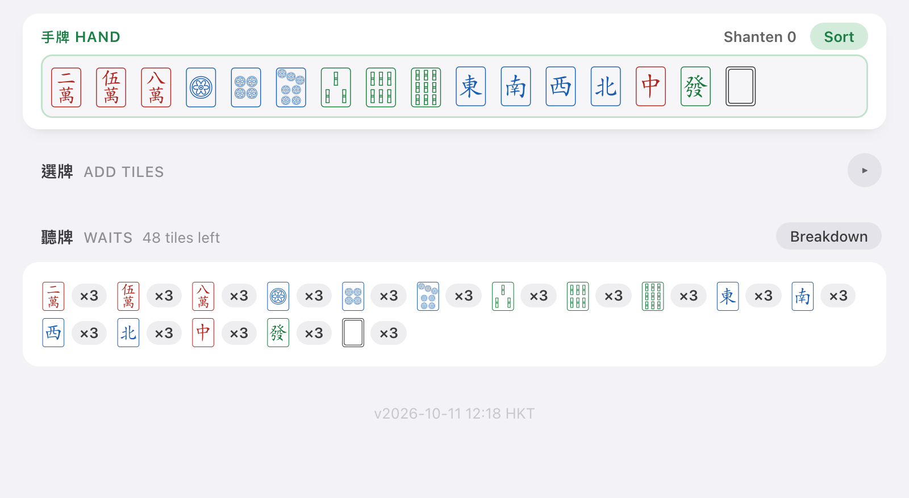
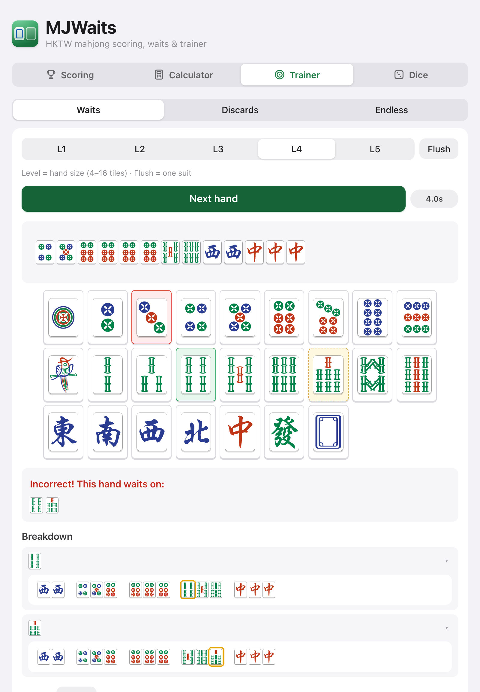
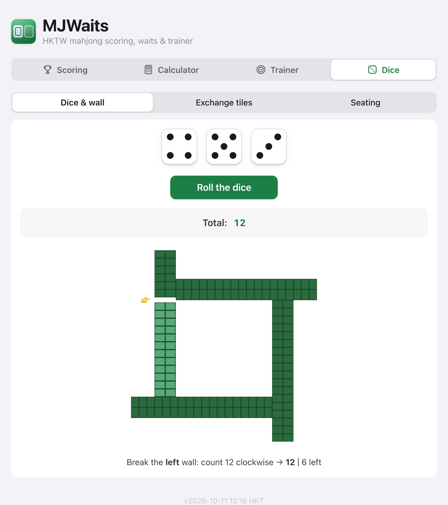

# MJWaits


A browser toolkit for 16-tile (Taiwanese / Hong Kong house rules) Mahjong. It started as a waits calculator — build a
hand, see what completes it and which discard gives the best odds — and has grown five tabs:

- **Scoring** — score a finished hand against a concrete house tai (番) list (~140 patterns).
- **Calculator** — the original: waits, shanten, joker resolution, and discard analysis.
- **Trainer** — timed quizzes: a **Waits** drill (name every tile that completes a hand) and a
  **Discards** drill (just drew — pick the single best tile to throw).
- **Scores** — keep score of a real game at the table (港式台牌 rules: 莊/連莊, 拉/踢, 一炮多響,
  反雪, Jackpot), with a stats page per player.
- **Dice** — roll for the wall, and see exactly where it breaks.

On a phone the five tabs sit in a bottom tab bar; on wider screens they're a segmented control
under the title. In the Scoring tab a sticky toolbar keeps Reset / Scan / Photos, the tile count
(or, once the hand scores, the total — tap it to jump to the breakdown) in view while scrolling.

Everything runs client-side, including the camera tile scanner. No hand ever leaves the browser.

**Install it** from the browser's menu (Safari: Share → Add to Home Screen): it opens full screen
like an app and **works offline** — after one visit with a connection, it loads with no signal,
and the tile scanner too once it has been used once. Updates arrive the next time it's opened
online, and an app left open (or paused in the background, as iPhone does) shows a
**New version available · Reload** bar once a newer build is live.

**Live app: [app.kevinlhc.com/mjwaits](https://app.kevinlhc.com/mjwaits/)**



## Scoring calculator (tai / 番)

The Scoring tab (the default on load) scores a **complete** winning hand against one concrete
house tai list — nearly 140 patterns, built up one at a time rather than as a configurable
ruleset. It totals tai; there's no point/currency conversion yet.

### Entering the hand

The input models the table, not a text string:

- **One shared tile picker** feeds both regions. A segmented control above it picks where a tap
  lands: **手牌** adds a single concealed tile; **上** (chow), **碰** (pung), **明槓** (exposed
  kong) or **暗槓** (concealed kong) drops that whole declared meld starting at the tapped tile
  (with 明槓 picked, a long-press declares a 暗槓 instead).
  Tiles that can't start the chosen meld grey out in place (the grid never reflows), and the
  flowers / seasons sit in their own row underneath and always go to 門前. The picker folds away
  by itself once the hand scores (and comes back if a tile comes off). The **?** on its header
  lists every tap and long-press; **Clear** there empties every tile, after a second, confirming
  tap.
- **Classic or Numpad** — the two icons next to 選牌 switch the picker's layout (remembered,
  and shared with the Calculator). Classic shows every suit at once; Numpad shows one group at a
  time — tabs for 花 字 | 萬 筒 索, lined up under 手牌 | 門前 — as a keypad of bigger keys: 1–9
  in a 3×3 grid for a suit, 東南西北 over 中發白 for the honors, the flowers over the seasons.
- **Your hand** shows both regions in one card: **門前 (Declared)** — everything laid in front of
  you — and **手牌 (Concealed)**, the tiles still in hand, as a plain multiset the scorer
  decomposes. Tap a tile or meld to remove it, or **Clear** in the 選牌 header to empty both regions; tap an empty part of a region to point the picker at it, or long-press it to clear just that region. While the card is
  scrolled out of view, a compact copy of the hand slides in under the toolbar — tap it to jump
  back. **Long-press** a concealed tile to mark it as the **食胡 tile** (the one that
  completed the hand) - or long-press a tile in the picker to add it already marked; several
  patterns depend on whether the completing meld was self-drawn or claimed off a discard.
- **Round wind** and **seat wind** (圈風 / 門風), each a row of the four wind tiles — tap one to
  stand it up — then a **莊** (dealer) button that steps up a 連莊 streak with +/−, a **自摸** (self-draw) toggle, and a strip of
  situational-declaration buttons that the tiles alone can't show. Most cycle on each tap:
  **叮 → 天叮 → 地叮** (riichi and its upgrades) with **一發** and **食叮** alongside;
  **四子內 / 七子內 / 十子內** (won within the first N discards); **雙響 / 三響** (multiple
  winners on one discard); **天胡 / 地胡 / 人胡**; **河底撈魚 / 海底撈月 / 海底撈月(一筒)** (won
  on the very last tile); count-based **花摸 / 槓摸 / 搶槓** (×N, each capped at the bonus tiles
  or kongs actually present); and a shared **明絕 / 絕絕**. These buttons wire each other up the
  way the rules interact — e.g. 自摸 auto-activates with 花摸 / 槓摸, any last-tile win, or 天胡,
  and is mutually exclusive with 搶槓 / 雙響 / 三響 / 地胡 / 食叮.

**Reset** clears the hand, the winds, and every one of these toggles, and cancels a scan that's
still running.

### Scoring

Special hands — 十三么 (Thirteen Orphans), 嚦咕嚦咕 (Eight Pairs), 十六不搭 (Sixteen Unrelated) —
are detected up front and scored by their own dedicated logic. Everything else is run through
**every** valid meld/pair decomposition of the hand, and the reading with the **highest total
tai** wins — which decomposition you pick genuinely changes the score. When a pattern lists an
exclusion, a matching "bigger" pattern suppresses the smaller one it names; unrelated patterns
stack freely, and several (清龍, 步步高, 四歸, …) fire more than once when a segment repeats
(the count is the product of the repeated segments' meld counts). A hand that is simultaneously
a valid Eight Pairs and a valid ordinary hand (嚦咕雙食) is shown scored both ways.

The result is the **tai total** plus a **matched-pattern list**: each row is a pattern name and
its tai, and tapping a row expands it to the exact tiles behind that pattern — one sub-row per
stacking instance. A sort toggle cycles the list through check-order / tai ↓ / tai ↑, and
pressing and holding one of an expanded row's groups lights it up in the hand strip under the
toolbar, which shows the scored decomposition (so the result doesn't repeat it).

### Projected scores

When the concealed hand is exactly one tile short of complete, the tab reuses the waits
calculator on it and shows, per wait, the score the whole hand would land on if that tile
completed it (each wait taken as its own 食胡 tile) — a collapsible list, sortable by score or by
tile. Kept deliberately narrow: no jokers, no concealed kongs.

### Sharing and recent hands

- **Share** - the icon on each **最近 Recent** row (the hand just scored is always the top one) - sends the hand as a link: **Copy link**, the system's **Share…**
  sheet where there is one, and on computers direct **WhatsApp**, **Telegram**, **Email** and **X**. The link carries the tiles, any flowers / seasons, and the situation
  (winds, 自摸 and the rest - only what differs from the defaults), so it opens to the same score.
  Opening one loads it into Scoring, then tidies the address bar.
- **最近 Recent**, at the bottom of the tab, keeps the last 10 hands that scored, on this device.
  Tap one to load it back, or share it from its row; changing only a hand's situation updates its
  entry rather than adding another. **Clear** (two taps) forgets them.
- The **Calculator** has the same: a share icon in its result caption (聽牌 Waits, 打牌 Discards or
  食糊) whose link opens on the Calculator with that hand, and its own **最近 Recent** list - each
  entry with what was found (waits, shanten, or a winning hand). Building a hand up tile by tile, or
  trimming it, keeps updating one entry.

[`docs/scoring-rules.md`](docs/scoring-rules.md) is the full reference — every tai value, its
criteria and exclusions, the 明 / 暗 (open / concealed) distinction, and the duplicate-instance
counting rules — kept in sync with the code.

## Calculator



### Hand input

- **Tap tiles** on the picker, or **type algebraic notation** directly
  (e.g. `123456789m111z11t22b`) — the two stay in sync. Laid out like the Scoring tab: Reset /
  Scan / Photos in a sticky toolbar, and the hand above the picker, pinned while the picker
  scrolls beneath it.
- Suits: `m` (man / characters), `t` (pin / circles), `b` (sou / bamboo), `z` (honors, 1–7 for
  East / South / West / North / Red / Green / White), `j` (joker).
- **Sort** toggle (in the 選牌 header; the shanten count shows in the 打牌 discards caption): on, new tiles are kept in
  sorted order as you add them; off, they stay in the order you entered them — and toggling back
  off restores that original order. Tap a hand tile to remove it, or long-press an empty part
  of the hand box to clear the whole hand.
- A 4-copies-per-kind cap is enforced automatically (jokers excluded — see below).

### Waits

- Enter a hand at any checkpoint size (1, 4, 7, 10, 13, 16 tiles) to see what completes it.
- A **universal wait** is flagged explicitly when any of the 34 tile kinds would complete the hand.
- Remaining copies of each waiting tile are always shown (4 minus what's already in hand), plus a
  running total across all waits.
- **Breakdown** (in the 聽牌 WAITS caption) shows the exact meld/pair decomposition for each wait, completing tile
  highlighted; a small `↔` button (once Breakdown is on) switches between pair-first and
  tile-order display. A hand genuinely ambiguous between two shapes (e.g. a standard hand that's
  also valid Eight Pairs) shows every valid reading, not just one.

### Shanten

A full numeric shanten count — not just tenpai / not-tenpai — for the minimum number of
discard+draw exchanges needed to reach tenpai. Covers the standard meld+pair shape plus Eight
Pairs and Sixteen Unrelated Tiles, and shows as a badge next to the hand.

### Discard analysis

Two related tools, depending on where you are in the hand:


Both blocks rate a discard with the same model: over the next **8 self-draws**, a two-phase
estimate of the chance to reach tenpai, and then to self-draw the win. Phase one advances to
tenpai at (accepting tiles ÷ unseen tiles) per draw; phase two wins at (wait tiles ÷ unseen) per
draw. Self-draw only — there's no opponent or discard-pile model — so the numbers read low and
are meant for *ranking*, not as table odds.

- **Discard efficiency** — at any checkpoint size that *isn't* tenpai, every discard is ranked by
  that win probability. Each one shows its tenpai/win percentages, how many tiles bring it to
  tenpai, and a two-step lookahead: every useful follow-up draw (with copies remaining) and what
  the hand would then wait on (with its own remaining count).
- **Discard options** — one tile past a checkpoint (i.e. right after drawing), each distinct
  discard is shown with what it leaves you: tenpai and its waits, or a shanten value and which
  draws would improve it, each with remaining-copy counts — plus the same tenpai/win percentages
  (a `—` for hands still 2+ shanten after the discard, which the model doesn't cover). A winning
  hand is called out as such — and, with Breakdown on, still shows its full decomposition plus
  what discarding anyway would leave you waiting on.

### Jokers (🀪)



Jokers are wildcards standing in for any tile. Add any number to a hand and the calculator works
out every wait they unlock, plus what each joker resolves to for a given wait — using a
wildcard-budget search rather than brute-forcing every substitution, so it stays fast with many
jokers in hand. With Breakdown on, the tile a joker stands in for is highlighted in purple within
its meld/pair group, distinct from the amber highlight on the tile you'd actually draw. (Discard
analysis isn't available yet for hands containing jokers.)

### Special hands



Beyond the standard five-melds-plus-a-pair shape, the calculator recognizes:

- **Thirteen Orphans** — all 13 terminal/honor kinds, one doubled as the pair, plus one ordinary meld.
- **Eight Pairs ("Liguligu")** — seven pairs plus one tripled pair (a full quad counts as two pairs).
- **Sixteen Unrelated Tiles** — all 7 honors plus 3 mutually "unrelated" ranks from each of
  man/pin/sou (no two close enough to ever share a chow), plus one tile doubling any of them for
  the pair.

Breakdown mode understands all three: Thirteen Orphans groups the pair, the 12 remaining singles,
and the extra meld; Eight Pairs shows the tripled kind first, then the other seven pairs;
Sixteen Unrelated shows the pair and the other 15 singles.

### Camera scan (📷)

Point a camera at a hand (or pick a photo) and have the tiles filled in automatically. Detection
runs entirely in-browser via [onnxruntime-web](https://github.com/microsoft/onnxruntime), using a
YOLOv8n (nano) model. No image is uploaded anywhere. Browsers with WebGPU run the full-precision
model (12.3 MB) on the GPU, about 8x faster per detection pass; everywhere else runs the same
model quantized to INT8 (3.4 MB) on the CPU (WASM). Add `?backend=cpu` to the page URL to force the
CPU path.

The Scan button opens the camera directly (there's a separate 🏞️ Photos button for an existing
shot). You then drag to crop out anything that isn't the hand, with a rotate control for sideways
photos; overlapping duplicate detections are dropped with non-max suppression, and a review step
draws a box over each detected tile (bonus tiles like flowers/seasons are boxed but greyed out
and excluded) before it replaces your hand. The **Scoring** tab uses the same scanner with two
crops — one for the 手牌區 concealed pile, one for the 門前牌區 declared pile — each labelled and
read back into the right region; if a scan of a Scoring hand comes back a genuine complete hand,
it's applied straight away with a persistent "✅ Hand applied from scan" banner and an **Adjust**
button back to the crop.

The model was trained on a merged dataset combining
[MahjongVis](https://github.com/Andy8647/MahjongVis) (MIT) and
[MJOD-2136](https://github.com/jaheel/MJOD-2136) (CC BY-NC-SA) across 42 tile classes (the 34
MJWaits recognizes plus 8 bonus-tile classes), then fine-tuned on real photos of a physical set
to close the gap between the training data's tile designs and a visitor's actual tiles - most
recently with a round adding rotation augmentation, fixing a real weakness where tiles rotated
90/180/270° (turned sideways on the table, or upside down) were missed far more often than
upright ones. On a held-out set of rotated photos, recall jumped from 0.746 to 0.902 and mAP50
from 0.738 to 0.871, at a small cost in box-localization tightness on upright photos (mAP50-95
0.766 → 0.721) - a worthwhile trade given how often a scanned hand has tiles at an angle. On the
full validation split the deployed checkpoint scores mAP50 0.916 / mAP50-95 0.683 / precision
0.955 / recall 0.906. See [training/README.md](training/README.md) for the full pipeline.

## Trainer

Three drills, on their own sub-tabs. **Waits** and **Discards** are timed one-shot quizzes with
five levels (Level 1 is a 1-meld hand, Level 5 the full 16-tile size), a **Flush mode** that
restricts every generated hand to one random suit, and their own stats table (broken down by
level and flush mode). **Endless** plays a single hand out non-stop. All stats are saved on the
device, so they survive switching tabs and reloading; each has a Reset button.

### Waits



Each question is a randomly generated hand (3·level + 1 tiles) guaranteed to have at least one
wait. The answer picker only shows suits actually present in the question, since a wait can never
come from a suit that isn't already there. Mark your guess, then submit: the picker flags each
pick as a correct hit, a wrong guess, or a wait you missed, and a full breakdown (same as the
Calculator's) shows how each real wait completes the hand. Stats: answered, correct, wrong,
% correct, average time.

### Discards


Each question is a random "just drew" hand (3·level + 2 tiles — a tenpai hand plus one drawn
tile). Tap the single tile you'd throw, then submit. It's graded against the Calculator's
*Discard options* analysis: the best discard is the one with the highest win probability over the
next 8 draws. Your pick and every equally-best discard are highlighted on the hand, and the full
list of every discard — ranked, with tenpai/win percentages — is shown below. Stats track how
often you found a best discard and your **average regret**: the win probability (in points) an
answer gave up versus the best.

### Endless

Press **Start** and you're dealt a full random hand, then play it out one draw at a time with no
prompts: tap a tile, it's discarded and graded, a replacement is drawn, repeat. A HUD tracks the
current turn and shanten, your best-discard rate, how many discards were **loose** (needlessly
raised shanten), average regret, and race stats — turns to first reach tenpai, turns to win,
hands won. When the hand is too far out for win probability to mean much, the HUD shows how many
tiles would move it toward tenpai instead.

The analysis accounts for your own discard pile *and* how much wall is left — tiles you've thrown
are gone, and the draw horizon shrinks as the wall runs down, so wait counts and probabilities
tighten as the hand goes on rather than assuming a fresh, full wall. After every discard the full
analysis of that turn is shown: which tile was best, how much win probability the pick gave up
(or, too far from tenpai for that to separate them, whether it raised shanten), and the ranked
list of discards with the best ones flagged — collapsed to just those while the hand is still 2+
shanten (the rows barely differ that far out), expandable to all of them. Discards pile up below
the hand, tinted by whether each was a best pick.

Completing a hand flashes a win summary; one tap deals the next. **Undo** / **Redo** (also
⌘/Ctrl+Z and ⇧⌘/Ctrl+Z) step back and forward through the current hand — hand, wall, discard pile
and every stat — as far as you like; **N** deals a new one, asking first if the current hand has
real progress to lose. History is cleared when a new hand is dealt, and a hand in progress
survives switching sub-tabs.

## Scores (計分)

A score keeper for a real game at the table, in tai, with the house rules of a 港式台牌
game. Everything is kept on this device (localStorage `mjwaits.scores`): the game in
progress, finished games and the player roster.

**戰況 (the board).** Set up four players in turn order (Seating's names are the starting
suggestion) and who deals first. The board fits the screen - it never scrolls. A slim status
row on top shows the round and deal (東風東局), the 局 count and 連莊, with a **最近** button
that opens every hand so far (newest first, with 還原); the actions sit underneath as one row
of icons. The players sit as a diamond of cards, each in its own colour: name, a 莊 tag on the
dealer, the running total in the middle (green up, red down) and the last hand's change
(上局). A **拉** shows on both cards, on the side facing the other player: +29 in green on the
card of whoever holds it, −29 in red on the one being pulled. 流局 and the Jackpot sit in the
middle. Tap a player to record for them - one sheet (rising from the bottom on a phone) with
two tabs:

- **食胡** — pick the 輸家 (or 自摸) and type the tai on the keypad. A breakdown shows what
  each payer owes, split into 底 · 番 · 莊 · 拉 · 總, and flags a payment over the 高分
  threshold. **一炮多響** switches to 雙響 / 三響: pick the discarder, the other winners and
  each one's tai. A **Jackpot** toggle appears when the pot has something in it.
- **特別獎罰** — a free-form 獎 (reward) or 罰 (penalty), either with everyone (each of the
  other three pays, or is paid, the amount) or with one player picked as From / To.

After each entry a toast offers a one-tap 還原.

The centre **流局** button records a draw. The toolbar: **新局** (file this game in History and
start another), **還原** (undo the last entry), **莊家** (set the dealer and 連莊, optionally
back to 東風東局), **換人** (swap seats, or bring in a 候補 player - totals stay with the player),
**拉踢** (every live 拉, each with 投降), **結帳** (the fewest payments that settle everyone,
× 倍數, and End game) and **設定**.

**How a payment is worked out.** One payer owes one winner: 底 + 番 + 莊 (自動計算莊 + 連莊 ×
自動計算連莊, only when one of the two is the dealer) + the pair's 拉/踢. (**封頂**, 999 by
default, only limits what the keypad accepts - no tai or 獎罰 amount above it can be typed - and
never changes a payment.)

- **拉** — once you've won off someone, the next hand you win off them is worth its value +
  half the 拉 (0.5進1 by default), and the 拉 grows by that worth: 11, then a 20 is worth
  26, and the 拉 is 37.
- **踢** — when they win back off you, that hand is worth its value + half your 拉 on them;
  your 拉 is gone and theirs starts at the plain value: 拉 29, then a 20 back is worth 35,
  and their 拉 is 20.
- A 自摸 counts pair by pair. A 流局 keeps every 拉; a hand the holder doesn't win ends theirs;
  投降 ends one with nothing paid.
- **反雪** — a player who dealt into a 雙響/三響 and 自摸s the very next hand is paid back by each
  of those winners: 5 after a 雙響, 10 after a 三響 (both settings).
- **Jackpot** — each 流局 every player puts the set amount in; a win can take it, or tap the
  pot to hand it out by hand.
- The dealer stays on a dealer win, or on a 流局 with 流局留莊; otherwise the deal moves on, and
  a full lap moves the round wind (執位提示 reminds you to re-seat).

The **Scoring** tab's result gets a **Record to Scores** button while a game is in progress:
it opens the 食胡 sheet with the winner picked by 門風, 自摸 set, and the tai minus any 莊/連莊
(the ledger adds its own), and keeps the hand's patterns for the stats.

**統計.** 玩家統計 cards (net, 胡 / 摸 / 銃 / 獎) over five views: **局** (every hand with each
player's change), **走勢** (running totals hand by hand, with a crosshair tooltip and
end-of-line labels), **牌型** (patterns from hands sent from Scoring), **玩家** (one player's
full grid - 食胡, 自摸, 出銃, 獎罰, 彩池, 最高番數, 平均食胡番 / 出銃番, 拉人 / 被拉 / 踢人 / 被踢 and
their records, 多響, 反雪, 最高得分 / 失分, 總自摸 / 出銃 得分 and 失分, 連勝, 助攻 and 助攻率, 正分率,
首名率 - with 👑 for the best at the table and 💀 the worst) and **紀錄** (every game, career
stats per player and head-to-head net tai).

## Play (hidden, in progress)

Not in the tab bar while it's being built: **long-press the logo** to open it (‹ on the table
goes back). A full hand of 16-tile mahjong against three bots that run in the browser, laid
out like a commercial 16-tile app. It's a landscape table: it fills the screen, and a phone
held upright is asked to turn sideways.

- **The table:** a green felt top in a dark wooden rim, tipped away from you in perspective
  so it narrows toward the far side. Each bot's concealed tiles stand along its edge - jade
  backs across the top, slanted walls down the sides - with its melds and flowers beside them
  and its pond out in front of it; their name cards sit flat over the table's corners. Tiles
  on the felt show their thickness (the ivory body and jade back below the face); in your
  hand the jade back peeks over the top. You're along the bottom, your melds and flowers
  inline before your hand and the tile you just drew set apart at the right.
  A wind compass in the middle shows each seat's wind where that seat sits and lights whoever
  is to act; its read-out is the live tiles left, or the countdown when the timer is on. The
  newest discard carries a gold pin, and while it can be claimed it also shows large in a
  spotlight beside the compass on the discarder's side. A call (上 / 碰 / 槓 / 胡 / 自摸) bursts up by whoever
  made it. The band along the bottom has your wind, 莊, your running total, the round and
  deal (e.g. 東圈南局, with any 連莊) and 剩:N張.
- **Rules:** 144 tiles with the 8 flowers/seasons (set aside and replaced from the back of
  the wall), 16 each, chow from the player on your left, pung, exposed / concealed / added
  kong with a replacement draw (a bot's concealed kong lies fully face down until the hand
  ends, and the 記牌器 and the bots count its tiles as unseen), win off a discard or by self-draw, and an exhaustive draw at
  the last 16 tiles. Win beats pung/kong beats chow; two wins off one discard go to the first
  in turn order. **食替:** straight after a call you can't throw the tile you claimed, nor,
  after a chow taken at one end of the run, the tile at its far side (take 7 with 56: 4 is
  barred too); barred tiles are greyed. No robbing the kong.
- **叮 (riichi):**
  - **Declaring:** when one of your discards would leave you ready, a red **叮** button
    appears. Tap it, then throw one of the tiles it leaves bright. That tile lies sideways in
    your pond and a 叮 tag goes on your name.
  - **After declaring** the hand is locked: each draw that doesn't win is thrown for you,
    and you can't call or kong, only win.
  - **Tai** (from the Scoring tab's list):
    - 叮 5, or 門清叮 10 with a concealed hand;
    - 天叮 60 (dealer) or 地叮 50, when declared with your first discard before any call;
    - 一發 5, a win before your next discard with no call in between;
    - 食叮 5 to whoever wins off a declared player's discard.
  - **Bots** declare too, by personality, when their wait is decent, and treat a declared
    player as certainly ready.
- **Playing:** tap a tile to lift it, tap again to discard. When you can call a discard,
  round call buttons (胡 / 槓 / 碰 / 上) appear above your hand with 過 to pass. 上 with more
  than one fitting shape asks which; 自摸 and kongs show on your own turn.
- **Menu (≡):** Hints Off / On, **Opponents**, a **turn timer** (Off by default, or 10s / 20s per decision; at
  zero it passes on a call, or throws the drawn tile, or the hint's pick after a call), and
  New game, which takes a second tap since it resets the totals. **記牌器** beside it lists how many of each tile you haven't seen yet.
- **Opponents (對手):** pick a ready-made table (Mixed; Tough, with two Grandmasters and a
  Veteran; Styles; Friendly) or any bot
  for each seat - Right, Across, Left - from the full roster, with each one's style shown.
- **Scoring:** a win is scored by the same tai list as the Scoring tab, with what the table
  knows filled in (seat and round wind, self-draw, the winning tile, last-tile and
  replacement-draw wins, 天胡/地胡/人胡, 莊 and 連莊). The discarder pays the tai; on a
  self-draw all three do. Running totals sit on each seat badge. The result card's **View
  table** hides it to look over the final table and the revealed hands; **Show result** brings
  it back.
- **Bots** (`src/lib/bots.ts`) all run one decision engine, and a personality sets its
  weights. A discard is ranked first on building the hand: shanten, then the unseen tiles
  that would improve it, then where its tai are heading (flushes, all-pungs, honour pungs,
  門清). Expected value then trades that against danger. A step toward ready is worth what it
  adds to the chance of winning × the hand's worth, and a throw costs its chance of dealing
  in × what that costs. So a far-off hand against a hot table simply throws safe tiles,
  with no separate fold switch.
  - **Threat:** how likely each opponent is to be ready. This is a fit to measured play,
    from melds called, discards made, a flush taking shape and a late run of middle tiles.
  - **Tile risk** reads, each kept because it measurably helps:
    - honours dead or nearly dead;
    - the tile already in that player's pond (safer, not safe, since there's no 振聽 here);
    - 壁 walls, where every copy of a neighbour is visible;
    - few copies left;
    - a weak flush read.
  - **Suji (筋) is left off on purpose.** With no furiten it measured no safer than any
    other tile.
  - **Calls** weigh the step gained, the value gained, the 門清 given up and 食替.
  - **Human feel:**
    - a softmax "noise" picks among near-equal moves, and the occasional lazy "slip" happens;
    - **thinking time follows the decision:** an obvious throw goes almost at once, a close
      or risky one gets a real pause, and a bot that had a call to weigh takes a moment
      before passing - a tell, as at a real table;
    - **memory:** the looser personalities remember only the most recent discards in each
      pond (the Casual about the last 8), so their reads and tile counts go fuzzy on early
      tiles the way a person's do;
    - **voices:** each personality says something in a speech bubble by its name when it
      calls, wins, self-draws, declares 叮 or deals in - the Speedster's 「要！要！」, the
      Iron Wall's 「……碰。」.
  - **Personalities:**
    - **宗師 Grandmaster:** the strongest bot evolution found - full speed, free calls,
      chases value, declares 叮 almost every time, barely defends, reads every discard.
    - **老手 Veteran:** quick and sharp; usually declares 叮, lets a small win go early in a
      hand, defends a little.
    - **快手 Speedster:** races to ready and calls almost everything; always declares 叮;
      defends only against a player who looks ready.
    - **大牌 Hunter:** chases flushes, all-pungs and honours, and passes on small wins early.
    - **鐵壁 Iron Wall:** keeps 門清, rarely declares 叮, shuts down against anyone who looks
      ready.
    - **賭徒 Gambler:** never folds; chases big hands at full speed and ignores everyone
      else's discards.
    - **街坊 Casual:** calls freely and loves 叮, but forgets older discards and makes the
      odd lazy throw.
    - All but the Hunter carry their species' evolved settings (see **Evolution** below).
  - **What the arena found** (1,200-hand runs, original bot as yardstick):
    - **Before 叮, speed beat everything.** Every win carries a solid 底 and about a third
      are self-draws, which every player pays, so every defensive setting lost more wins
      than it saved deal-ins.
    - **Declaring 叮 pays.** Always declaring when ready: +2.3 tai a hand, against −2.0 for
      never declaring.
    - **With 叮 in play, moderate defence pays too,** because a declared player is known to
      be ready. Caution 0.35: +1.2, against −1.3 for none and −0.4 for heavy.
    - **Defending only against clearly-ready players** (a `focus` setting) did worse than
      the light all-round caution.
    - **The Veteran** (always 叮, caution 0.35, eager calls, a little human noise) scores
      **+2.5 tai a hand to the original bot's +0.2**.
  - **Hints** use the Veteran's judgement.
- **Arena** (`npm run arena`): the bots play each other headless and a results table prints:
  - net tai per hand;
  - win, self-draw and deal-in rates;
  - average win and loss;
  - win speed, calls per hand and biggest win.

  Each wall is dealt four times with the bots rotated a seat each time, so the luck of the
  deal largely cancels out. Work is split across CPU cores. Options:
  - `--bots a,b,c,d`;
  - `--walls N`;
  - `--seed`;
  - `--list`;
  - `--tweak "v2:veteran.caution=0.4"`, to try a variant against the original;
  - `--calibrate`, which prints how often seats are really ready by melds × discards, and
    how often each risk read's buckets really won. That's where the threat and risk numbers
    come from.
- **Evolution** (`npm run evolve`): the bots improve themselves by self-play, one species per
  style. Each species keeps its settings within its style's limits (a Hunter stays greedy,
  an Iron Wall stays careful), so evolution finds the strongest version of each style rather
  than turning every bot into the same one; the Grandmaster species has no limits.
  - **Each generation:** the whole population is shuffled into mixed tables of four and
    plays duplicate-dealt hands. Within each species the best half (by lifetime net tai a
    hand, shrunk while a bot has few hands) survive, and the rest are replaced by children
    of two survivors - each setting from one parent, then mutated within the limits.
  - **Benchmark:** every few generations each species' champion plays a fixed table of the
    original Veteran, the original efficiency-only bot and the original Speedster, so
    progress is measured against bots that don't evolve.
  - **Dashboard:** `node scripts/evolve-report.mjs evolution/<run>` writes a report page:
    each species' champion, the benchmark trend, the best-in-species trend, where each
    style's settings drifted, and a sortable leaderboard of every bot alive.
  - **First run** (`evolution/species1`, 112 generations, about 230,000 hands, ~4.5 hours):
    - The fast, calling, 叮-declaring styles led throughout; heavy defence never paid.
    - In 1,200-hand tournaments every evolved champion beat its own original personality
      (Gambler +7.7 vs −2.8, Iron Wall +1.8 vs −3.1, Speedster +1.5 vs −3.2, Veteran +1.8
      vs −0.1, Casual −0.3 vs −4.6) except the Hunter, which tied (+0.6 vs +0.7) and keeps
      its original settings.
    - The strongest line was the evolved **Gambler**: fast, greedy, 叮 almost every time,
      almost no defence. With full memory and table reading added it became the
      **Grandmaster**. The two are about level - each won one of two 1,200-hand tables
      against the evolved roster - so the reads add little; against three copies of the
      original efficiency-only bot the Grandmaster scores **+2.4 tai a hand**.
  - The engine is fast enough for this because hand-distance (shanten) results are cached
    per suit shape and the pruning of meld options is linear; together about 4× faster.
- The dealer stays on a dealer win or a draw; a full lap of dealers moves the round wind. The
  game in progress, and the hint, opponents and timer settings, are kept on this device, so leaving the
  table or reloading picks it back up.

## Dice



Two sub-tabs:

- **Dice & wall** — three tappable d6 (tap a die to nudge its face, or roll for an animated
  tumble that settles on one result). The total sits in a box tinted green for a three-of-a-kind
  and red for a 1-2-3. Below it the full built wall is drawn as four 2×18 tile-back bars in a
  pinwheel offset, and the dice sum breaks it: the app counts round to the right seat, marks the
  opening with a 👉, and captions which side is broken and how many stacks are counted off.
- **Exchange tiles** — a two-die roller for the pre-deal exchange. One die (a labelled "Round"
  box) picks a round 1–3, the other ("Tiles") a count with a floor of 3, and it shows Round,
  Tiles, and their product.

## Notation reference

```
123456789m111z11t22b   5 melds + a pair
1278m555t111333777z    mixed suits and honors
jjjj                   4 jokers, no rank needed
```

Digits before a suit letter are that many tiles of that suit; jokers are written as a run of bare
`j` characters since they have no rank.

## Development

```bash
npm install
npm run dev      # start the dev server (http://localhost:5173/mjwaits/)
npm test         # run the test suite (vitest)
npm run lint     # oxlint
npm run build    # typecheck + production build
```

The core engine (parsing, shanten, waits, joker resolution, discard analysis) lives in
[`src/lib/mahjong.ts`](src/lib/mahjong.ts), covered by an extensive suite in
[`src/lib/mahjong.test.ts`](src/lib/mahjong.test.ts) including brute-force cross-validation for
the trickier joker and shanten logic. Trainer question generation is in
[`src/lib/trainer.ts`](src/lib/trainer.ts) with property-based checks across all levels and flush
mode. The scoring engine — notation parsing, the all-decompositions search, and the `PATTERNS`
tai list — is in [`src/lib/scoring.ts`](src/lib/scoring.ts), tested in
[`src/lib/scoring.test.ts`](src/lib/scoring.test.ts); see
[`docs/scoring-rules.md`](docs/scoring-rules.md) for what each pattern does. The client-side tile
detector (letterboxing, ONNX inference, non-max suppression) is in
[`src/lib/vision.ts`](src/lib/vision.ts).

A hidden developer sheet opens on three quick taps of the logo (a long-press opens the hidden Play table instead). **Test hands** loads any hand
from the scoring tests (or a random one). **Tools** has: the tile style; a live layout overlay
(page height, the bottom spacer, space below the footer); loading or copying the Scoring hand as
notation; the latest calculation timings; Trainer switches to reveal the answers or repeat a
question; the last scan's raw detections with confidences; device info (viewport, pixel ratio,
safe area, home-screen mode); and a reset for everything the app saved in the browser.

Offline support is a small hand-written service worker, [`public/sw.js`](public/sw.js) (registered in
production builds only): the page network-first (revalidated past GitHub Pages' 10-minute HTTP cache), Vite's hashed `assets/` cache-first, everything
else (the detector model, icons) served from cache and re-checked in the background. The install
icons, the link-preview image and the iPhone / iPad launch screens (`public/splash/`, one per screen
size, listed in `index.html`) are rendered by [`scripts/make-icons.mjs`](scripts/make-icons.mjs). Opened from the
home screen, the page also draws the same splash itself (`#splash` in `index.html`, faded out by
`src/main.tsx`), since iOS shows a launch image only when one matches the screen exactly.

The README screenshots are regenerated from a running dev server with
[`scripts/shoot-readme-screenshots.mjs`](scripts/shoot-readme-screenshots.mjs) (needs
`npm i puppeteer-core --no-save` and a local Google Chrome).

Built with React, TypeScript, and Vite; deployed to GitHub Pages via GitHub Actions on every push
to `main`.

See [ROADMAP.md](ROADMAP.md) for future ideas (a live camera viewfinder, extending joker
resolution into shanten and discard analysis, point/currency conversion for scoring).

## Credits

The tile art is adapted (cropped to the tile face) from the oblique mahjong tile set on
[Wikimedia Commons](https://commons.wikimedia.org/wiki/Category:SVG_Oblique_illustrations_of_Mahjong_tiles)
by Cangjie6 et al., licensed [CC BY-SA 4.0](https://creativecommons.org/licenses/by-sa/4.0/) - see
[src/assets/tiles/CREDITS.md](src/assets/tiles/CREDITS.md). The hidden developer sheet (tap the logo
three times) can switch back to the Unicode tile glyphs.

The camera scanner's tile detector is a [YOLOv8](https://github.com/ultralytics/ultralytics) model
by Ultralytics ([AGPL-3.0](https://www.gnu.org/licenses/agpl-3.0.html)), trained on
[MahjongVis](https://github.com/Andy8647/MahjongVis) by Andy8647 (MIT) and
[MJOD-2136](https://github.com/jaheel/MJOD-2136) by jaheel
([CC BY-NC-SA 4.0](https://creativecommons.org/licenses/by-nc-sa/4.0/); merged with MahjongVis and
relabelled - see [training/README.md](training/README.md)), and runs in the browser on
[ONNX Runtime Web](https://github.com/microsoft/onnxruntime) (MIT). The app is built with
[React](https://react.dev) (MIT).

In the app, **Credits** in the footer lists all of these with their licences.
